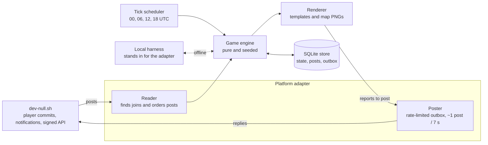

# NULL SPACE: MVP specification

Nov 19, 2026 · @Gary

## Overview

NULL SPACE is a turn-based trading game played entirely by posting commits to a bot account, @nullspace, on dev-null.sh. The MVP proves one loop: move around a hex map, harvest and trade three goods for profit, and meet other players near the start.

The setting: everything ever piped to /dev/null ends up in an endless void of drifting junk. Each player captains a small salvage ship.

Design principles:

- **Play by mail, not real time.** Orders are collected and resolved together on a fixed tick, every 6 hours. Each player gets at most one reply per tick.
- **One thread per captain.** All of a player's orders are replies in their own thread, so the public timeline only sees join posts and one daily bulletin.
- **The engine knows nothing about dev-null.sh.** A pure game engine takes orders and returns reports. A thin adapter handles the platform.
- **Deterministic.** The same seed, state and orders always give the same result, so every tick can be replayed and tested.

## MVP scope

The MVP is trading only, with no combat and no building. Everything not listed as in is out.

| Area | In the MVP | Out of the MVP |
| --- | --- | --- |
| Joining | `@nullspace join`, instant welcome reply | Invites, referral rewards |
| Map | Seeded endless hex map, Hub at the centre, personal fog of war | Hex naming, player-written lore |
| Actions | `move`, `scan`, `harvest`, `buy`, `sell`, `offer`, `accept`, `name`, `status`, `help` | Building, combat, crafting |
| Economy | 3 goods, stations with supply-driven prices | Production chains, contracts board |
| Ship | Fuel per tick, 3 upgrades bought at the Hub | Multiple ships, crew |
| Other players | Seeing ships in scans, trades in the same hex | Chat, guilds, piracy |
| Risk | One table of deep-void events | Fightable pirates |
| Output | Join reply, turn reports with a map image, daily bulletin | Web map viewer |
| Seasons | One open-ended season, reset by hand | Scheduled seasons |

## How a player plays

A player joins with one top-level commit, then plays by replying in that commit's thread. That thread is their captain's log.

1. **Join.** The player posts a top-level commit containing `@nullspace join`. Any other text is allowed.
2. **Welcome.** The bot replies to that commit within a few minutes, outside the tick. The reply gives the ship's name, starting position, hold, fuel, credits, Hub prices, a map image and the command list.
3. **Orders.** Before the next tick, the player replies anywhere in their own log thread with a post containing a fenced code block of orders. Text outside the block is ignored by the game.
4. **Tick.** At 00:00, 06:00, 12:00 and 18:00 UTC the engine resolves every player's orders together.
5. **Report.** The bot replies to the player's latest orders post with a turn report and a map image.
6. **Repeat** from step 3.

Rules:

- Ticks run every 6 hours. A player who sends no orders for a tick gets no reply, and their ship stays where it is.
- Commits can't be edited on dev-null.sh, so a player corrects orders by posting again. The latest orders post before the tick wins. The report says how many earlier posts were ignored.
- An orders post that is still pending moderation at tick time isn't visible to the bot, so it counts for the next tick.
- A deleted orders post is ignored.
- Posts that mention @nullspace outside a registered log thread get no reply, except a new `join`.
- A player who joins twice keeps their first log thread. The bot replies once to the second join, pointing to the first thread.

## Orders

The engine reads only the first fenced code block in a post, one order per line, at most 10 lines. Orders run top to bottom.

| Order | Example | Effect | Fuel |
| --- | --- | --- | --- |
| `move <dir> [<dir> ...]` | `move ne ne ne` | Moves one hex per direction: `n`, `ne`, `se`, `s`, `sw`, `nw` | 1 per hex |
| `scan` | `scan` | Charts every hex within scanner radius and lists what's there | 0 |
| `harvest` | `harvest` | Takes goods from the field in the current hex. Once per tick | 0 |
| `buy <good> <qty>` | `buy cycles 40` | Buys from the station in the current hex | 0 |
| `sell <good> <qty\|all>` | `sell cycles all` | Sells to the station in the current hex | 0 |
| `offer @user <qty> <good> for <qty> <good\|cr>` | `offer @alice 18 entropy for 400 cr` | Opens a trade offer (see Player trades) | 0 |
| `accept @user` | `accept @you` | Accepts that player's open offer | 0 |
| `upgrade <part>` | `upgrade hold` | Buys the next upgrade level. Hub only | 0 |
| `name <ship name>` | `name The Segfault` | Renames the ship, up to 32 characters | 0 |
| `status` | `status` | Adds a full ship and market summary to the report | 0 |
| `help` | `help` | Adds the command list to the report | 0 |

Parsing rules:

- Commands and goods are case-insensitive. Extra spaces are ignored.
- A line that fails, for example an unknown command, not enough fuel, credits or hold space, or no station here, is skipped. The report says why. Every other line still runs.
- An unknown command gets a "did you mean" hint when it is within edit distance 2 of a real one.
- A `move` that runs out of fuel stops at the last hex it could reach.
- `buy` with more than the hold or credits allow buys as many as fit, and the report says so.
- `upgrade` covers the three parts in the Ship section. A post with no code block is not an orders post and gets no reply.

## The world

The map is an endless flat-top hex grid generated on demand from a season seed. A hex's contents are a pure function of the seed and its coordinates, so nothing is stored until something changes.

- **Coordinates:** axial `(q, r)`. Directions: `n` (0,−1), `ne` (+1,−1), `se` (+1,0), `s` (0,+1), `sw` (−1,+1), `nw` (−1,0). Distance is the usual axial hex distance.
- **Ring:** a hex's distance from the Hub at (0,0). The ring sets how rich and how crowded it is.
- **Generation:** `hash(seed, q, r)` picks the hex's type and properties. Each hex is empty, a station or a field.
- **Density falls off with distance:** stations are common near the Hub and rare far out, while fields get richer and rarer goods appear.
- **Stored changes only:** field stock left, station stock and prices, and which hexes each player has charted.
- **Spawn:** new ships start on a random empty hex in ring 1 or 2, so early players meet.
- **Fog of war is per player.** Each player sees only hexes they have charted, by scanning or passing through.

Starting generation table, to be tuned in playtests:

| Ring | Station chance | Field chance | Field goods |
| --- | --- | --- | --- |
| 0 | The Hub | — | — |
| 1–4 | 12% | 20% | Mostly cycles |
| 5–9 | 6% | 18% | Cycles and entropy |
| 10–15 | 3% | 15% | Entropy and legacy |
| 16+ | 1% | 12% | Mostly legacy, richest fields |

Station and field names come from seeded word lists with a developer theme, for example Grepstone Relay or Kernel Panic Depot.

## Economy

Profit comes from buying where a good is cheap and selling where it is scarce. Every trade moves the price, so players compete through the markets.

| Good | Base price | Found in | Units per harvest |
| --- | --- | --- | --- |
| Cycles | 11 cr | Near the Hub | 20–30 |
| Entropy | 28 cr | Middle rings | 12–20 |
| Legacy | 45 cr | Far rings | 6–12 |

**Stations**

- The Hub buys and sells all three goods, with a spread of about 15% between its buy and sell prices.
- Every other station is seeded with a role per good: it **sells** the good (cheap, below base), **buys** it (pays above base), or doesn't trade it. Each station trades two of the three goods.
- A station's price for a good starts from base × a seeded factor: 0.6–0.85 where it sells, 1.25–1.7 where it buys.

**Prices respond to trades**

- Each unit a player sells to a station lowers that station's price for the good by 0.5%. Each unit bought raises it by 0.5%.
- Prices are clamped to 50%–200% of base.
- Each tick, every price moves 25% of the way back to its starting value.
- Trades apply one unit at a time, so a large sale gets a slightly worse average price.

**Fields**

- A field holds a seeded stock, for example 400–900 units, that only goes down in the MVP.
- `harvest` takes a random amount in the good's range, capped by hold space and the field's stock.
- An empty field stays empty for the rest of the season. Scans show a field's stock as rough bands: rich, worked, thin, empty.

**Starting ship:** 500 cr, empty hold.

## Ship

Every ship starts with a 40-unit hold, 12 fuel and a scanner radius of 2. Fuel refills to full at the start of each tick and can't be stored or bought.

| Upgrade | Level 1 (start) | Level 2 | Level 3 |
| --- | --- | --- | --- |
| `hold`: cargo capacity | 40 units | 60 units, 900 cr | 80 units, 2,000 cr |
| `engine`: fuel per tick | 12 | 16, 1,200 cr | 20, 2,800 cr |
| `scanner`: scan radius | 2 | 3, 650 cr | 4, 1,600 cr |

- Upgrades are bought with `upgrade <part>` at the Hub only and take effect immediately.
- Ships get a random two- or three-word name at join, for example The Segfault. `name` changes it.
- **Net worth** = credits + cargo valued at the Hub's buy prices + half of what was spent on upgrades. It ranks the leaderboard.

## Player trades

Two players in the same hex can swap goods or credits. An offer stays open for two ticks, so the other player doesn't have to be online in the same 6-hour window.

- **Offer:** `offer @alice 18 entropy for 400 cr`. Both ships must be in the same hex when the offer resolves. Each side can be a good or `cr`.
- **Notification:** the @mention in the offering post notifies Alice through the platform. Her next turn report also lists the open offer.
- **Accept:** `accept @you`, from Alice's own log thread. It works in the same tick as the offer, or either of the next two.
- **Settlement:** at resolution both ships must still share a hex, and each must hold what they're giving and have room for what they get. The swap is all or nothing.
- **Limits:** one open offer from each player to each other player. A new offer replaces the old one. An offer expires after two ticks or when the offering ship leaves the hex.
- Both reports say whether the trade settled, failed (and why) or expired.

## Deep-void events

Each hex a ship enters in ring 5 or beyond has a 10% chance of triggering one event. At most one event per ship per tick. Events add risk to long hauls.

| Roll (d100) | Event | Effect |
| --- | --- | --- |
| 1–30 | Drifting cache | +5–15 of a random good, capped by hold space |
| 31–50 | Solar wind | The rest of this tick's moves cost double fuel |
| 51–70 | Hull breach | Lose 10–25% of one good in the hold |
| 71–85 | Scrapper pirates | Lose 15% of credits, or 20% of cargo if they're worth more |
| 86–100 | Old beacon | Charts every hex within radius 4 for free |

Each event has two or three flavour-text variants so the reports don't repeat. Pirates can't be fought in the MVP.

## Bot output

The bot writes three kinds of post, all from templates. No language model writes them, since the platform's rules ban AI-generated posts. Every post must fit dev-null.sh's limits: 4,000 characters, up to three images of 10 MB each, and image descriptions of up to 1,000 characters.

| Post | When | Where | Contents |
| --- | --- | --- | --- |
| Welcome | Within minutes of a `join` | Reply to the join commit | Ship name, position, hold, fuel, credits, Hub prices, map image, command list, time of next tick |
| Turn report | After each tick, only for players who sent orders | Reply to the player's latest orders post | One line per order (✓ done or ✗ skipped, with the reason), scan results, events, trade results, open offers to the player, status line, map image, time of next tick |
| Daily bulletin | After the 00:00 tick | Top-level commit | Player count, hexes charted, biggest price moves, nearly empty fields, top 5 by net worth, trades settled |

**Turn report format** follows the mock-up canvas: a monospaced block with a `TICK n` header, `✓` and `✗` lines, then `SCAN`, `NEARBY` and `EVENTS` sections, then one status line: `HOLD 18/40 entropy · FUEL 11/12 · 780 cr`.

**Map image**

- A PNG of the player's charted hexes, centred on their ship and roughly 9 hexes across.
- Distinct fills for the Hub, stations, fields, charted empty hexes and uncharted void. Other ships are dots, and this tick's route is a dashed line.
- Short labels inside hexes (HUB, station initials, the field's good).
- The image description is generated alt text listing what is in view, for example "Grepstone Relay here, entropy field 1 hex north, Alice's ship 2 hexes south".

**Voice:** short, dry, slightly ominous. Each template has a few variants chosen by the seeded RNG so reports don't read identically.

## Architecture

The game engine is a pure function: `resolve(state, orders, tick) → (newState, reports)`. Everything that talks to dev-null.sh lives in a separate adapter, so the local harness can replace it completely.

The reader and the local harness both feed orders in. Reports go to the renderer and then the outbox. Only the poster spends the 10-posts-a-minute budget.

**Tick resolution order**

1. At the cutoff, take each player's latest visible orders post since the previous tick.
2. Refill every ship's fuel, and move every station price 25% back towards its starting value.
3. Shuffle the players with the seeded RNG for this tick. The order changes every tick, so posting early gives no advantage.
4. Run each player's orders in that order, top to bottom. Moves, harvests and trades take effect immediately, so earlier players move prices and drain fields for later ones. Offers are recorded.
5. Settle accepts in the same order, then expire old offers.
6. In one transaction, save the new state, render every report and add it to the outbox.

**Storage (SQLite)**

| Table | Holds |
| --- | --- |
| `players` | Handle, log thread root commit, ship name, position, hold, credits, upgrades |
| `hexes` | Only changed hexes: field stock, station prices |
| `charted` | Which hexes each player has seen |
| `order_posts` | Commit ID, player, tick, whether used or superseded |
| `offers` | From, to, both sides, hex, expiry tick |
| `outbox` | Post kind, reply-to commit, body, image, alt text, status, attempts |
| `ticks` | Tick number, seed, resolved time |

**Reliability**

- A tick is resolved once: its number is saved in the same transaction as the new state.
- Outbox rows are keyed by player and tick. The poster marks a row as sent with the returned commit ID, so a restart resumes where it stopped and never double-posts.
- Every processed commit ID is stored, so a post is never read twice.
- The RNG for each tick is seeded from the season seed and the tick number, so any tick can be replayed from a backup.

**Stack:** TypeScript on Node, SQLite and a canvas library to draw the map PNGs. This is a default, easy to change before milestone 1.

## Platform constraints and open questions

The bot's 10 posts a minute is the hard limit, and it shapes the tick design. These figures come from dev-null.sh's [knowledge base](https://github.com/dev-null-sh/dev-null.sh/blob/production/KNOWLEDGE_BASE.md#public-read-api-and-atom-feeds).

| Limit | Value | What it means for NULL SPACE |
| --- | --- | --- |
| Posting (commits, replies, quotes) | 10 per minute per user | About 600 bot posts an hour. 500 active players' reports take about 50 minutes to go out after a tick |
| Signed API | 120 requests per minute per user | The budget for reading notifications and posting |
| Public read API | 60 requests per minute per IP, no auth | Fallback for reading players' replies. 20 commits per page |
| Post length | 1–4,000 characters, up to 3 images | Caps report length |
| Moderation | Some posts need human review before they're visible | Orders and bot posts can be delayed by an unknown amount |
| Content rules | No AI-generated posts, spam, engagement bait or low-effort posts | Bot text is templated. Orders posts with no other text could look low-effort |

Open questions:

- [ ] Get the maintainers' OK, and ask whether @nullspace can be auto-approved by moderation.
- [ ] Find the signed API route for reading notifications. The docs say it exists but don't list it.
- [ ] Check whether commit JSON includes a parent or root ID, so the bot can tell a reply belongs to a player's log thread.
- [ ] Check whether commit JSON includes a created time distinct from approval time, to decide which counts against the tick cutoff.
- [ ] Confirm how the bot uploads an image and its description through the signed API.

## Build plan

Build the game offline first, and connect it to dev-null.sh only once it's fun in the local harness.

1. **Engine and map generation.** Seeded hexes, ships, every order, prices, fields, events and trades. Done when unit tests cover every order and its failure cases, and replaying a tick gives identical results.
2. **Local harness.** Play several simulated players from the terminal, with text reports and the map saved as PNG. Done when a three-player game can be played for 20 ticks by hand.
3. **Balance pass.** Script bot players (a trader, an explorer, a harvester) and run 200 ticks. Done when no single strategy clearly dominates and a typical player can afford their first upgrade within about 8 ticks.
4. **Platform reader.** Detect joins and orders posts on dev-null.sh, store them, and feed them to the engine without posting. Done when a dry run against real posts produces correct reports locally.
5. **Platform poster.** Rate-limited outbox, welcome replies, turn reports with images, daily bulletin. Done when a closed test with 5–10 friends runs a week without double posts or missed reports.
6. **Open launch.** One season, reset by hand.

## Further iterations

Possible improvements after the MVP, not yet specified:

- Reasons to write flavour text: log text broadcast as chatter in nearby players' scans, naming and describing discovered hexes, stations that remember regulars, and a hand-picked Log of the Day in the bulletin
- Outposts and base building on claimed hexes
- Fightable pirates (PvE)
- Player combat and interdiction, with commit-reveal orders so the last player to post can't read and counter the others
- Guilds built on dev-null.sh Orgs
- Scheduled seasons with map resets and season rewards
- More goods and production chains
- A public contracts board for buy and sell orders
- Field regrowth and shifting markets
- A read-only web map viewer
